# CRM Architecture & Comparative Alignment Specification
**Nexus CRM vs. Energia CRM (Power Equipment Rental)**  
*Document Version: 1.0 | Date: November 2026*

---

## 1. Unified End-to-End Commercial Flowchart

Both **Nexus CRM** and **Energia CRM** share this core commercial lifecycle from customer enquiry to signed contract/order execution.

```mermaid
flowchart TD
    %% Styling Classes
    classDef sales fill:#e0f2fe,stroke:#0284c7,stroke-width:2px,color:#0f172a;
    classDef ops fill:#dcfce7,stroke:#16a34a,stroke-width:2px,color:#0f172a;
    classDef mgmt fill:#fce7f3,stroke:#db2777,stroke-width:2px,color:#0f172a;
    classDef credit fill:#fef3c7,stroke:#d97706,stroke-width:2px,color:#0f172a;
    classDef legal fill:#ede9fe,stroke:#6366f1,stroke-width:2px,color:#0f172a;
    classDef decision fill:#ffffff,stroke:#475569,stroke-width:2px,stroke-dasharray: 4 4,color:#0f172a;
    classDef exitState fill:#fee2e2,stroke:#ef4444,stroke-width:2px,color:#7f1d1d;
    classDef termNode fill:#1e293b,stroke:#0f172a,stroke-width:2px,color:#ffffff;

    %% Process Nodes
    START([Customer Enquiry]):::termNode --> STEP1["1. Lead / Enquiry Intake
    • Client and source recorded
    • Equipment / load requirement (kVA)
    • Site location & hire period needed
    • Deduplication check"]:::sales

    STEP1 --> STEP2["2. Opportunity Qualification
    • Need and budget qualified
    • Key decision-maker identified
    • Expected start date
    • Competitor noted"]:::sales

    STEP2 --> DEC1{"Site Survey Required?"}:::decision

    DEC1 -- Yes --> STEP3_OPS["3. Operations Site Survey
    • Engineer site visit & positioning markup
    • Unit, cable run, and fuel tank placement
    • Load demand assessment (kVA)
    • Site safety, truck access & permits
    • Prepare itemized BOQ"]:::ops

    DEC1 -- No --> STEP4_QUOTE

    STEP3_OPS --> STEP4_QUOTE["4. CPQ Quote Creation
    • Survey BOQ auto-priced
    • Fleet / inventory availability verified
    • Day / Week / Month rental rates
    • Minimum hire period applied
    • Mobilisation & demobilisation fees
    • Fuel, operator, deposit & insurance"]:::sales

    STEP4_QUOTE --> STEP5_APPR["5. Management Quote Approval
    • Discount and margin policy validation
    • Tiered hierarchy: SM -> SH -> MD/CEO
    • System locked until fully signed off"]:::mgmt

    STEP5_APPR --> STEP6_SENT["6. Quote Dispatched to Client
    • Win probability set to 30%
    • Official PDF / public link sent
    • Expiry validity date set & reminders scheduled"]:::sales

    STEP6_SENT --> STEP7_ENGAGE["7. Follow-up & Communication
    • Calls, site visits, and emails logged
    • Client queries & revisions answered
    • Client actively engaging: Raise to 60%"]:::sales

    STEP7_ENGAGE --> DEC2{"Client Proceeding?"}:::decision

    DEC2 -- No --> EXIT_LOST["Exit: Lost Database
    • Record exact drop reason
    • Quote expired / lost to competitor / budget
    • Archived for retargeting"]:::exitState --> END_LOST([Process Ended - Lost]):::termNode

    DEC2 -- Yes --> STEP8_PO["8. Payment Terms & PO Confirmation
    • Payment terms finalized
    • Client PO verified: rate, period, site & value
    • Formal order acknowledgement dispatched
    • Win probability raised to 90%"]:::sales

    STEP8_PO --> STEP9_CREDIT["9. Credit Check & KYC Due Diligence
    • Triggered strictly at 90% leads
    • Raised by Sales Manager to Credit team
    • AOF, Trade License, and CR verified
    • Credit limit & credit terms set
    • Outstanding balance check"]:::credit

    STEP9_CREDIT --> DEC3{"Credit Approved?"}:::decision

    DEC3 -- No --> EXIT_CREDIT["Credit Declined
    • Decline reason recorded
    • Fallback: Offer 100% advance payment
    • Client informed"]:::credit

    EXIT_CREDIT --> DEC2

    DEC3 -- Yes --> STEP10_LEGAL["10. Rental Contract Signed
    • Sales + Legal team review
    • Agreed hire period and rental rates
    • Breakdown response SLA (e.g. 2h / 4h)
    • Damage & loss liability terms
    • Insurance cover & return inspection criteria
    • Counter-signed by both parties"]:::legal

    STEP10_LEGAL --> END_WON([Process Complete - Rental Active]):::termNode
```

---

## 2. Common Foundational Modules & Contents

These modules form the **shared platform base** used by both CRMs. They handle the core commercial data structures and workflows.

### 2.1 Sales & Pipeline Management Module
* **Primary Entities:** `Lead`, `Deal` (Opportunity), `PipelineStage`, `DealContact`, `LeadSource`, `DealMilestone`
* **What is Inside:**
  * **Omnichannel Lead Intake:** Captures leads from Web, Twilio WhatsApp, Inbound Email (Gmail parser), and Phone.
  * **Intelligent Deduplication:** Matches incoming leads against existing phone numbers, email domains, and commercial registrations to prevent duplicate rep outreach.
  * **Deal Kanban Pipeline:** Visual stage management with automatic win probability progression:
    * `30%`: Quote Generated & Dispatched
    * `60%`: Active Negotiation / Client Engagement
    * `90%`: Purchase Order Confirmed & Terms Agreed
    * `100%`: Contract Signed / Won
  * **Deal Ownership & Splits:** Multi-rep collaboration on high-value enterprise accounts via `DealSplit`.
  * **Lost Opportunity Archival:** Mandatory capture of loss category (pricing, delivery lead time, lost to competitor, project shelved).

### 2.2 Account & Contact CRM Core
* **Primary Entities:** `Account`, `Contact`, `LeadContact`
* **What is Inside:**
  * B2B organization hierarchy (Parent Accounts, Branch Locations, Operational Sites).
  * Contact roles and authority tagging (Primary Decision Maker, Site Engineer, Procurement Officer, Finance/Accounts Payable).
  * 360-degree timeline consolidating all communications, quotes, contracts, and field visits.

### 2.3 Operations & Site Survey Module
* **Primary Entities:** `SiteInspection`, `SiteBase`, `SiteFacility`, `SiteInspectionService`
* **What is Inside:**
  * **Dispatch & Scheduling:** Booking qualified technical survey engineers to visit client sites.
  * **Geolocation & Navigation:** GPS pin resolution via WhatsApp and one-tap turn-by-turn navigation for field teams.
  * **Technical Site Markup:** Capturing physical dimensions, cable run lengths, connection points, access clearance, and environmental restrictions.
  * **BOQ Compilation:** Compiling surveyed requirements into an itemized Bill of Quantities that feeds directly into the CPQ builder.

### 2.4 Governance & Multi-Tier CPQ Approvals
* **Primary Entities:** `ApprovalRequest`, `ApprovalTier`, `AdminApprovalPolicy`, `ApprovalAuditLog`
* **What is Inside:**
  * **Guardrail Matrix:** Automated checks against discount caps, payment terms, and gross margin thresholds.
  * **Hierarchical Escalation Chain:**
    * **Tier 1:** Sales Manager (SM) approval for minor discounts.
    * **Tier 2:** Section Head (SH) approval for extended payment terms or medium discounts.
    * **Tier 3:** Managing Director / CEO (MD) approval for high-risk, non-standard terms, or zero-margin deals.
  * **Dispatch Lockdown:** Quotes cannot be exported to PDF or sent to clients until all required approval tiers are completed.

### 2.5 Omnichannel Communication & Activity Hub
* **Primary Entities:** `Activity`, `CallLog`, `Meeting`, `EmailMessage`, `WhatsAppLog`, `Notification`
* **What is Inside:**
  * Unified customer timeline displaying calls, logged site visits, emails, and two-way WhatsApp chats.
  * Real-time notification banners and mobile/desktop alerts for approval requests and quote status changes.

---

## 3. Comparative Module Breakdown by CRM

### 3.1 Nexus CRM Specific Modules

These modules are currently operational in the codebase and serve Nexus CRM's specific business model:

| Module | Purpose in Nexus CRM | Build Status in Codebase | Key File References |
| :--- | :--- | :---: | :--- |
| **Subscriptions & Recurring Billing** | Recurring software/service retainers, automated monthly MRR tracking, renewal cycles. | **Built & Complete** | [subscriptionController.ts](file:///Users/saud/Projects/CRM/backend/src/controllers/subscriptionController.ts) [AccountDetail.tsx](file:///Users/saud/Projects/CRM/frontend/src/pages/AccountDetail.tsx) |
| **Field Service & Work Orders** | Complete technician dispatch, skill tagging, work order lifecycle, customer sign-off feedback. | **Built & Complete** | [workOrderController.ts](file:///Users/saud/Projects/CRM/backend/src/controllers/workOrderController.ts) [FieldService.tsx](file:///Users/saud/Projects/CRM/frontend/src/pages/FieldService.tsx) |
| **Attendance & Break Tracking** | Live sales rep clock-in/out, team break policies, and real-time lead routing availability. | **Built & Complete** | [attendanceController.ts](file:///Users/saud/Projects/CRM/backend/src/controllers/attendanceController.ts) [SalespersonTracker.tsx](file:///Users/saud/Projects/CRM/frontend/src/pages/SalespersonTracker.tsx) |
| **Twilio WhatsApp Integration** | Omnichannel two-way customer messaging with consent/opt-out management and message templates. | **Built & Complete** | [whatsappController.ts](file:///Users/saud/Projects/CRM/backend/src/controllers/whatsappController.ts) [CommunicationCenter.tsx](file:///Users/saud/Projects/CRM/frontend/src/pages/CommunicationCenter.tsx) |
| **Invoicing & Payments** | Standard customer invoices, payment recording, milestone billing, and PDF receipts. | **Built & Complete** | [invoiceController.ts](file:///Users/saud/Projects/CRM/backend/src/controllers/invoiceController.ts) [Invoices.tsx](file:///Users/saud/Projects/CRM/frontend/src/pages/Invoices.tsx) |
| **AI Reports & KPI Master** | Rep performance scorecards, coaching notes, and AI-driven pipeline velocity analytics. | **Built & Complete** | [aiReportController.ts](file:///Users/saud/Projects/CRM/backend/src/controllers/aiReportController.ts) [kpiMasterController.ts](file:///Users/saud/Projects/CRM/backend/src/controllers/kpiMasterController.ts) |

---

### 3.2 Energia CRM (Power Equipment Rental) Modules

These modules represent the specialized requirements for the **Energia CRM** rental workflow:

| Module | Purpose in Energia CRM | Build Status in Codebase | Work Required to Complete |
| :--- | :--- | :---: | :--- |
| **Credit Check & KYC Management** | Due diligence at 90% probability: Trade License, Commercial Registration (CR), Account Opening Form (AOF), credit limit & terms underwriting. | **To Build (0%)** | • Create `CreditApplication` & `KycDocument` tables. • Build Credit Department review queue. • Implement 100% Advance Payment fallback branch when credit is denied. |
| **Rental Contract & Legal SLAs** | Equipment hire contract generation with breakdown response SLAs (e.g. 2h/4h response), damage liability, insurance, and dual e-sign. | **To Build (0%)** | • Create `RentalContract` entity and contract template generator. • Add SLA commitment clauses and liability terms. • Implement customer and company e-sign workflow. |
| **Equipment Rental CPQ Engine** | Rate cards supporting Day / Week / Month pricing multipliers, minimum hire periods, and mobilization/demobilization charges. | **Partial (Needs CPQ Extension)** | • Add hire duration multipliers to `QuoteLineItem`. • Add line item categories: Mobilisation, Demobilisation, Fuel, Certified Operator, Auxiliary Cable. • Enforce minimum rental periods. |
| **Fleet Asset Availability Checking** | Checking real-time generator and equipment availability across requested rental dates prior to quoting. | **Partial (Needs Booking Engine)** | • Existing `Asset` model tracks equipment. • Need rental booking calendar to verify equipment is not double-booked during hire window. |
| **Equipment Site Survey Extensions** | Survey form capturing generator pad placement, cable lengths, auxiliary fuel tank positioning, and load assessment (kVA). | **Partial (Needs Template Config)** | • Existing `SiteInspection` module provides full engine, GPS pin, and photo capture. • Add equipment rental survey checklist and auto-push to quote BOQ. |
| **Client PO Intake & Validation** | Validating incoming customer POs against quoted rates, rental duration, delivery site, and validity dates at 90% stage. | **Partial (Needs Logic)** | • Existing `PurchaseOrder` handles purchasing. • Adapt to validate customer PO data against the parent `Quote` before releasing to Credit. |
| **Win Probability Event Automations** | Automatic deal stage advancement: 30% (Quote Sent) $\rightarrow$ 60% (Client Engaged) $\rightarrow$ 90% (PO Confirmed) $\rightarrow$ 100% (Signed). | **Partial (Needs Trigger Configuration)** | • Stages exist in `PipelineStage`. • Configure event hooks in backend controllers to auto-bump deal probabilities based on actions. |

---

## 4. Architectural Summary

1. **Shared Foundation (One Engine):**  
   Both CRMs share over **70% of the underlying codebase**: Leads, Opportunities, Accounts, Contacts, Quoting basics, Approval hierarchies, Activities, and Site Inspection routing.
2. **Nexus CRM Retains:**  
   Its specialized modules (**Subscriptions**, **Attendance**, **Work Orders / Field Service**, **Twilio WhatsApp**) remain active as modular add-ons.
3. **Energia CRM Adds:**  
   The primary additions needed to complete the Energia CRM flow are the **Credit & KYC Due Diligence Engine**, the **Rental Contract & SLA Module**, and **Rental Rate Card (Day/Wk/Mo) CPQ Extensions**.
